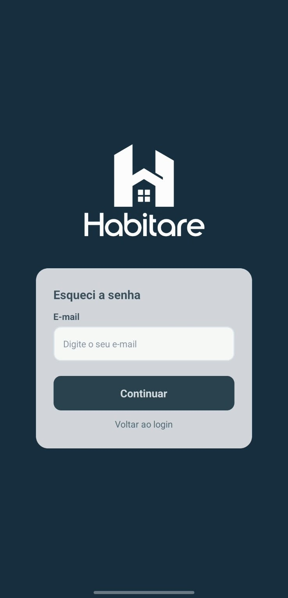
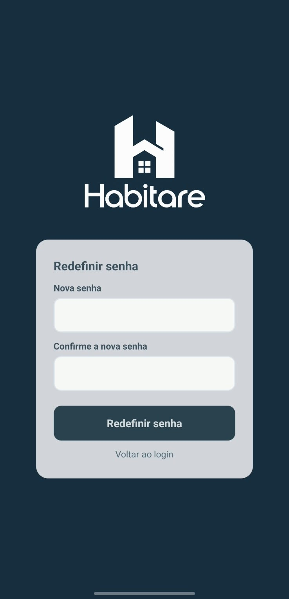
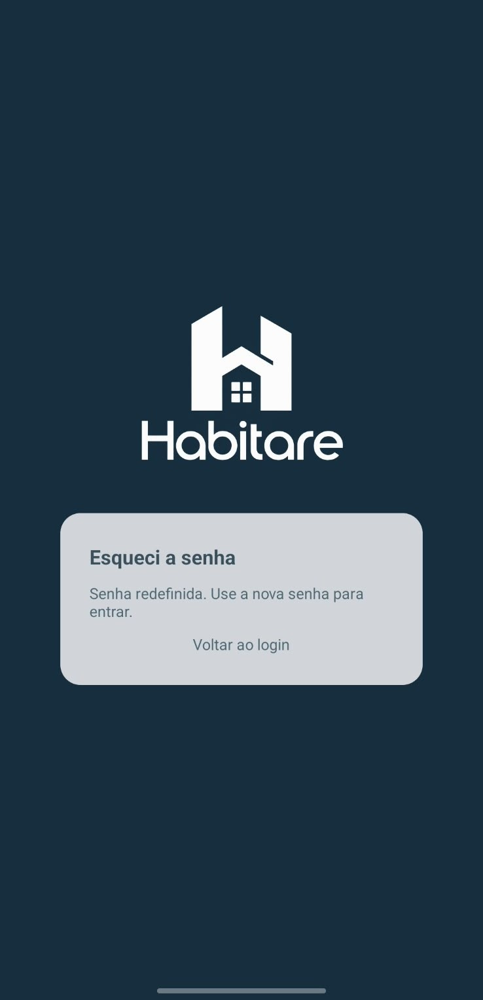
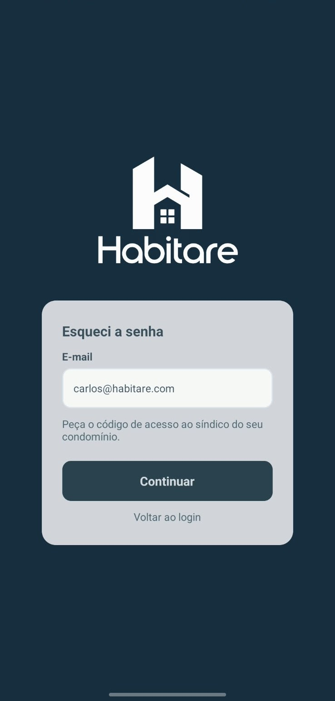
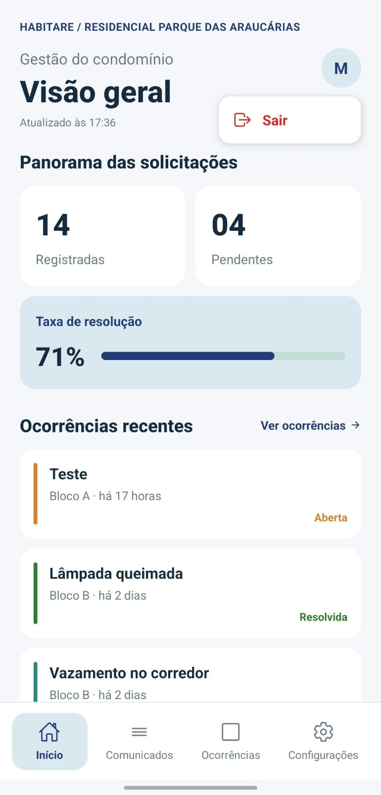

# Ajustes adicionados em telas

Durante o desenvolvimento, o grupo percebeu alguns alementos faltantes para o funcionamento completo do app.

## Tela Esqueci a senha

Não havia sido criada a tela no wireframe, então foi seguido o padrão da tela de login para estruturar as telas faltantes

_Esqueci a senha_

_Ao informar o e-mail do sindico_

_Sucesso ao redefinir senha_

_Ao informar o e-mail do morador_

## Botão de sair

Durante a montagem do wireframe, não foi pensado aonde ficaria o botão de sair. O mesmo é acionado ao clicar no ícone do usuário no topo direito da tela

