# Wireframes

Os wireframes apresentados nesta seção representam a estrutura visual e funcional do App mobile **Habitare**.

Foram desenvolvidas as seguintes telas:

## 0. Login

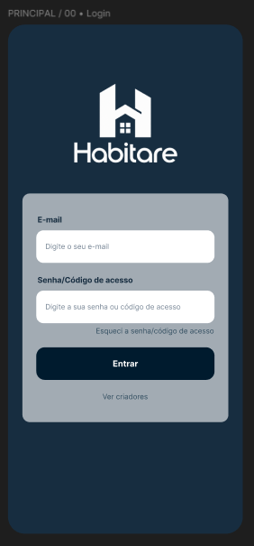

## 1. Dashboard | Sindico

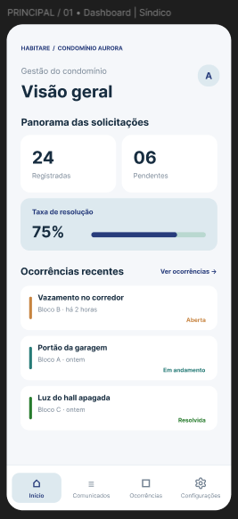

## 2. Comunicados | Sindico

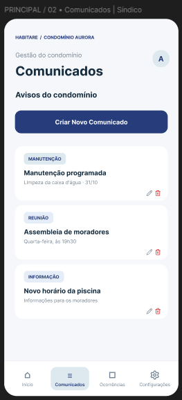

## 3. Novo comunicado

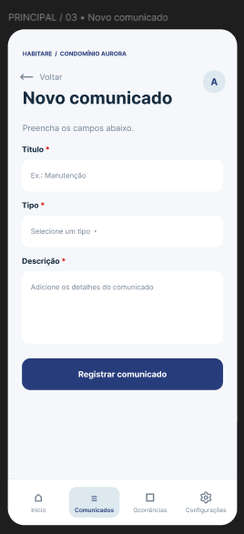

## 4. Ocorrências | Sindico

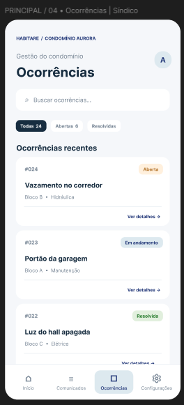

## 5. Ocorrências | Ver detalhes

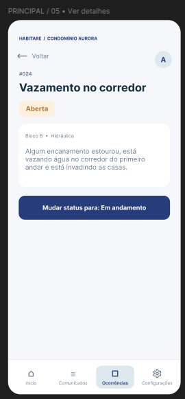

## 6. Configurações | Blocos

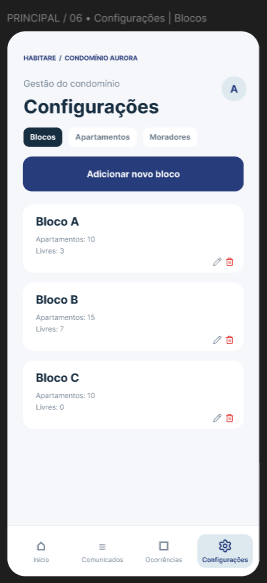

## 7. Novo bloco

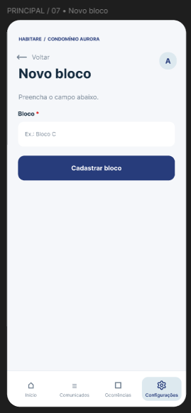

## 8. Configurações | Apartamentos

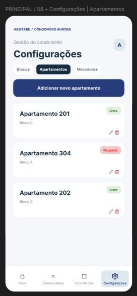

## 9. Novo apartamento

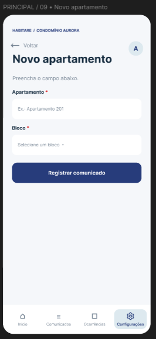

## 10. Configurações | Moradores

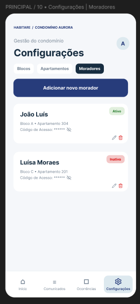

## 11. Novo morador

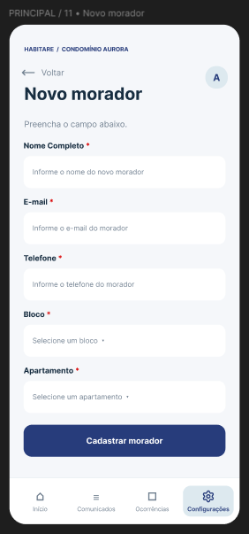

## 12. Inicio | Morador

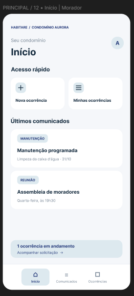

## 13. Comunicados | Morador

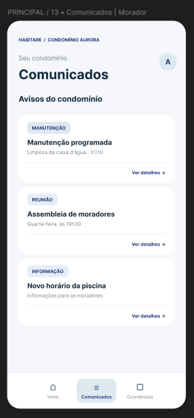

## 14. Comunicados | Ver detalhes

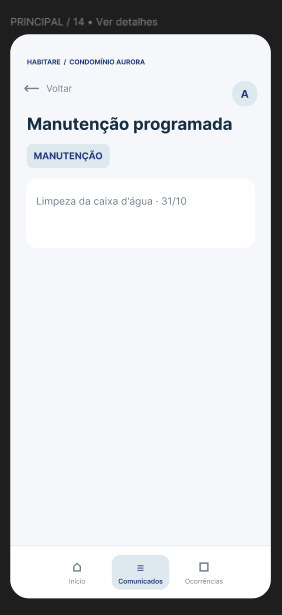

## 15. Ocorrências | Morador

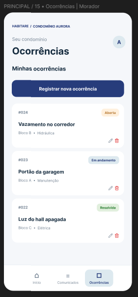

## 16. Nova ocorrência

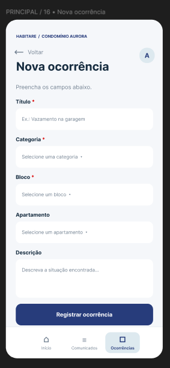

## 17. Criadores

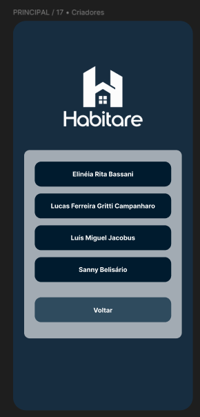